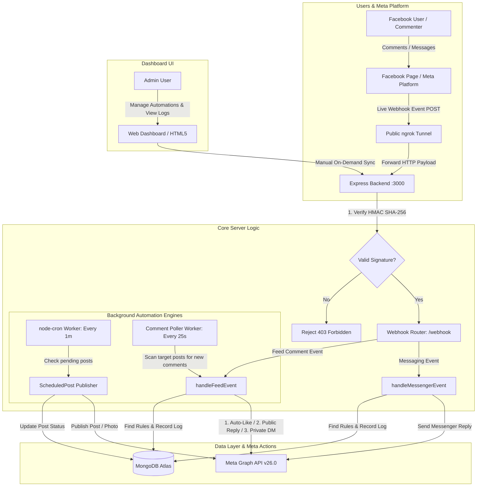
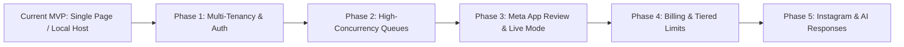

# 📘 Facebook Automation MVP - Complete Architecture, Technical Guide & SaaS Roadmap

---

## 🌟 Table of Contents
1. [Project Overview & Core Mission](#1-project-overview--core-mission)
2. [End-to-End System Architecture](#2-end-to-end-system-architecture)
3. [Deep Dive: Comment Automation & The 25-Second Question](#3-deep-dive-comment-automation--the-25-second-question)
4. [File-by-File Codebase Directory](#4-file-by-file-codebase-directory)
5. [Complete REST API Endpoints Reference](#5-complete-rest-api-endpoints-reference)
6. [Meta Graph API Scopes & Permissions Matrix](#6-meta-graph-api-scopes--permissions-matrix)
7. [Comprehensive SaaS Roadmap (From MVP to Commercial Product)](#7-comprehensive-saas-roadmap-from-mvp-to-commercial-product)

---

## 1. Project Overview & Core Mission

The **Facebook Automation MVP** is an automated marketing, engagement, and customer acquisition engine for Facebook Pages. It bridges the official **Meta Graph API v26.0** with an Express.js backend and a MongoDB database to automate:

1. **Instant Messenger DMs**: Direct replies to Facebook Messenger messages based on keyword matching (exact/contains) or generic fallback greeting.
2. **Post-Specific & Global Comment Automation**:
   - Automatically likes incoming user comments.
   - Automatically posts threaded public replies under comments.
   - Automatically sends private Messenger DMs to commenters via Meta's **Private Replies API**.
   - Supports rule-based keyword matching or global Page-wide defaults.
3. **Scheduled Post Publisher**: A background cron worker that schedules and auto-publishes text, photo, and link posts to Facebook feeds at specified future timestamps.
4. **Live Activity & Diagnostics Stream**: Real-time event logging, webhook HMAC signature verification, token permissions inspector, and on-demand comment synchronization.

---

## 2. End-to-End System Architecture

### 🔄 System Architecture Diagram



---

## 3. Deep Dive: Comment Automation & The 25-Second Question

### ❓ Why Were Comments Taking ~25 Seconds, and Can We Make It Instant?

During development and local testing, you noticed comments were processed on a periodic cycle (~25 seconds) rather than appearing in the exact second you typed them. Here is the technical explanation and the path to sub-second speed:

#### 1. Why the Poller Was Introduced: Meta's Development Mode Limitations
* **Meta Development Mode Webhook Suppression**: When a Meta App is in **Development Mode**, Meta **suppresses live `feed` webhooks** for real comments on production Facebook Pages. Meta’s webhook infrastructure is strictly gated: until an app is submitted for App Review and switched to **Live Mode**, real user comment webhooks are often not dispatched.
* **Page Admin Self-Action Suppression**: Meta explicitly filters out webhook events when the Page Administrator or App Creator comments on their own Page to prevent feedback loops.
* **The Solution We Built (`commentPoller.js`)**: To make sure your automation works 100% reliably regardless of Meta's Development Mode restrictions, we built an automated background poller that queries `GET /{post_id}/comments` every 25 seconds. When a new comment is found, it feeds it into the exact same processing pipeline (`handleFeedEvent`), auto-liking and replying.

#### 2. How to Overcome the 25-Second Delay & Achieve Instant (<500ms) Replies

| Method | Response Latency | How It Works | When to Use |
| :--- | :--- | :--- | :--- |
| **Instant Webhook Push** | **200ms – 600ms** | Meta fires a real-time `POST /webhook` instantly when someone comments. The server processes and replies immediately. | **In Production / Live Mode** after Meta App Review approval. |
| **On-Demand Manual Sync** | **Instant (on-click)** | User clicks `🔄 Sync & Reply Comments Now` on the dashboard; the server immediately calls Meta Graph API and processes comments in < 2 seconds. | Local development and instant live demonstrations. |
| **Background Poller (Current)** | **0 – 25 seconds** | Periodic background sweep ensuring zero missed comments even if Meta suppresses webhooks. | Local testing, dev mode, and as a fallback fail-safe in production. |

> [!TIP]
> **Production Best Practice**: In a commercial SaaS version, you use **both**:
> 1. Primary: Real-time **Meta Webhooks** deliver 99% of replies in **under 1 second**.
> 2. Secondary: The **Poller runs as a background reconciliation cron** (e.g., every 5 minutes) to catch any comments dropped by network blips or Meta API hiccups.

---

## 4. File-by-File Codebase Directory

```
facebook_automation_mvp/
├── server.js                   # Application entry point, Express setup, cron & startup
├── .env                        # Environment variables (App ID, Secret, DB URI, etc.)
├── models/                     # Mongoose Data Models
│   ├── Automation.js           # Comment & Messenger automation rules
│   ├── Page.js                 # Connected Facebook Page tokens & metadata
│   ├── ScheduledPost.js        # Scheduled post queue & publishing logs
│   └── WebhookEvent.js         # Audit log of all incoming events & executed actions
├── routes/                     # Express API Route Handlers
│   ├── webhook.js              # Meta webhook verification & event processing pipeline
│   ├── pages.js                # Facebook Page connection, OAuth exchange & scopes check
│   ├── comments.js             # Comment automations CRUD, simulation & manual sync
│   ├── messenger.js            # Messenger keywords & reply rules CRUD
│   ├── posts.js                # Instant post publishing & scheduling queue
│   └── events.js               # Webhook event stream & statistics for dashboard
├── services/                   # External API & Worker Integrations
│   ├── meta.js                 # Meta Graph API client (DMs, likes, replies, posts)
│   └── commentPoller.js        # Background poller for live comment reconciliation
└── public/                     # Vanilla HTML/CSS/JS Responsive Frontend
    ├── index.html              # Landing page, Page connect & OAuth flow
    ├── dashboard.html          # Control center, readiness diagnostics & live activity feed
    ├── comments.html           # Comment automations manager & interactive simulator
    ├── messenger.html          # Messenger keyword rules manager
    ├── posts.html              # Post composer & scheduled posts manager
    ├── style.css               # Shared modern dark/light CSS design tokens
    └── privacy.html, terms.html, data-deletion.html # Meta compliance legal pages
```

---

### Detailed Breakdown of Every File

#### 1. Core Server & Configuration
* **[server.js](file:///c:/Users/PC/Desktop/facebook_automation_mvp/server.js)**:
  - Initializes Express, mounts JSON parsers with `rawBody` capture for cryptographic HMAC verification.
  - Connects to MongoDB Atlas with auto-reconnect retry loops.
  - Launches the scheduled post publisher cron (`* * * * *` every minute).
  - Starts the automated background comment poller (`commentPoller.startPoller(25000)`).
  - Handles the OAuth redirect flow `/auth/facebook` with automatic redirect URI resolution.
* **[.env](file:///c:/Users/PC/Desktop/facebook_automation_mvp/.env)**:
  - Holds `PORT`, `MONGODB_URI`, `META_APP_ID`, `META_APP_SECRET`, `META_WEBHOOK_VERIFY_TOKEN`, and `BASE_URL` (ngrok tunnel).

#### 2. Data Models (`models/`)
* **[models/Page.js](file:///c:/Users/PC/Desktop/facebook_automation_mvp/models/Page.js)**:
  - Stores the active Facebook Page details (`pageId`, `pageName`, `pageAccessToken`, `userAccessToken`, `category`, `tasks`, `isConnected`, `webhookSubscribed`).
* **[models/Automation.js](file:///c:/Users/PC/Desktop/facebook_automation_mvp/models/Automation.js)**:
  - Stores automation rules for both `messenger` and `comment` types.
  - Fields for comments: `postId`, `postMessage`, `isGlobal`, `autoLike`, `publicReply`, `messengerReply`, `keywords`, `isEnabled`.
  - Fields for messenger: `trigger` (`any_message` / `keyword`), `rules` (array of `{ keyword, matchType, replyText }`).
* **[models/ScheduledPost.js](file:///c:/Users/PC/Desktop/facebook_automation_mvp/models/ScheduledPost.js)**:
  - Stores scheduled posts (`pageId`, `message`, `link`, `mediaUrl`, `scheduledTime`, `status` [pending, published, failed], `publishedPostId`).
* **[models/WebhookEvent.js](file:///c:/Users/PC/Desktop/facebook_automation_mvp/models/WebhookEvent.js)**:
  - Audit trail storing every incoming event (`eventType`, `senderId`, `postId`, `commentId`, `messageText`, `status`, `actionsTaken`, `error`, `rawPayload`).

#### 3. Route Controllers (`routes/`)
* **[routes/webhook.js](file:///c:/Users/PC/Desktop/facebook_automation_mvp/routes/webhook.js)**:
  - `GET /webhook`: Meta Webhook Verification handshake. Verifies `hub.verify_token` and echoes `hub.challenge`.
  - `POST /webhook`: Ingests real-time events. Validates `X-Hub-Signature-256` HMAC. Dispatches to `handleMessengerEvent` or `handleFeedEvent`.
  - `handleMessengerEvent`: Matches keywords, prevents page self-replies, sends DM replies via `metaService.sendMessengerMessage`.
  - `handleFeedEvent`: Matches post-specific or global rules, filters keywords, auto-likes comment, posts public reply, sends private DM, logs to `WebhookEvent`.
* **[routes/comments.js](file:///c:/Users/PC/Desktop/facebook_automation_mvp/routes/comments.js)**:
  - CRUD for comment rules (global fallback and post-specific rules).
  - `POST /api/comments/sync`: Immediately triggers `commentPoller.syncRecentComments()`.
  - `POST /api/comments/simulate`: Previews rule matching in memory without contacting Meta.
  - `POST /api/comments/test-webhook`: Dispatches mock or real comment IDs into `handleFeedEvent` for end-to-end testing.
* **[routes/pages.js](file:///c:/Users/PC/Desktop/facebook_automation_mvp/routes/pages.js)**:
  - Manages Page connection, token exchange (short-lived user token to long-lived Page token), webhook subscription status.
  - `GET /api/pages/permissions`: Calls Meta Graph `/debug_token` to inspect granted token scopes and readiness.
* **[routes/messenger.js](file:///c:/Users/PC/Desktop/facebook_automation_mvp/routes/messenger.js)**:
  - Manages Messenger greeting and keyword response rules.
* **[routes/posts.js](file:///c:/Users/PC/Desktop/facebook_automation_mvp/routes/posts.js)**:
  - Publishes instant posts or schedules future posts into `ScheduledPost`.
* **[routes/events.js](file:///c:/Users/PC/Desktop/facebook_automation_mvp/routes/events.js)**:
  - Serves event logs and analytics metrics (`/api/events/stats`) to the dashboard.

#### 4. Services (`services/`)
* **[services/meta.js](file:///c:/Users/PC/Desktop/facebook_automation_mvp/services/meta.js)**:
  - Wrapper for all Meta Graph API calls:
    - `getLongLivedUserToken`, `getAvailablePages`, `subscribePageToWebhooks`.
    - `getPagePosts`, `publishPagePost`, `publishPagePhoto`.
    - `sendMessengerMessage`, `replyToComment`, `likeComment`, `sendPrivateReplyToComment`, `debugToken`.
* **[services/commentPoller.js](file:///c:/Users/PC/Desktop/facebook_automation_mvp/services/commentPoller.js)**:
  - The live synchronization engine. Scans posts, checks MongoDB for duplicate execution, and triggers `handleFeedEvent`.

#### 5. Frontend Pages (`public/`)
* **[public/dashboard.html](file:///c:/Users/PC/Desktop/facebook_automation_mvp/public/dashboard.html)**:
  - Central command center: 4-step readiness diagnostics (Database, Tunnel, Meta App, Facebook Page), metrics cards, action buttons, and live stream of webhook events.
* **[public/comments.html](file:///c:/Users/PC/Desktop/facebook_automation_mvp/public/comments.html)**:
  - Global comment settings, post-specific automation manager, live comment simulator, and on-demand sync button.
* **[public/messenger.html](file:///c:/Users/PC/Desktop/facebook_automation_mvp/public/messenger.html)**:
  - Messenger keyword rule builder with exact/contains match options.
* **[public/posts.html](file:///c:/Users/PC/Desktop/facebook_automation_mvp/public/posts.html)**:
  - Post composer with link preview, photo scheduling, and status tracking.
* **[public/index.html](file:///c:/Users/PC/Desktop/facebook_automation_mvp/public/index.html)**:
  - Welcome portal with Facebook OAuth connect buttons and setup walkthrough.

---

## 5. Complete REST API Endpoints Reference

### 🌐 System & Diagnostic Endpoints

| Method | Endpoint | Description | Request Body | Response |
| :--- | :--- | :--- | :--- | :--- |
| `GET` | `/health` | Server and database health check | None | `{ status: "ok", mongodb: { status: "connected" }, meta: {...} }` |
| `GET` | `/api/pages/permissions` | Checks token scopes via Meta `/debug_token` | None | `{ connected: true, scopes: [...], readiness: {...} }` |
| `GET` | `/webhook` | Meta Webhook Handshake verification | Query: `hub.mode`, `hub.challenge`, `hub.verify_token` | Echoes `challenge` text (HTTP 200) |
| `POST` | `/webhook` | Meta Webhook event receiver | Raw Meta Webhook Event JSON | `'EVENT_RECEIVED'` (HTTP 200) |

### 📄 Pages & Connection

| Method | Endpoint | Description | Request Body |
| :--- | :--- | :--- | :--- |
| `GET` | `/api/pages/current` | Get currently connected Facebook Page | None |
| `POST` | `/api/pages/select` | Connect a selected Facebook Page | `{ pageId, pageAccessToken, pageName, category, tasks }` |
| `POST` | `/api/pages/disconnect` | Disconnect active Facebook Page | None |
| `POST` | `/api/pages/subscribe-webhooks` | Subscribes Page to app webhooks via Graph API | None |

### 💬 Comment Automations

| Method | Endpoint | Description | Request Body |
| :--- | :--- | :--- | :--- |
| `GET` | `/api/comments/automations` | List all comment automation rules | None |
| `GET` | `/api/comments/global` | Get global comment automation fallback | None |
| `POST` | `/api/comments/global` | Save global comment automation fallback | `{ isEnabled, autoLike, publicReply, messengerReply, keywords }` |
| `POST` | `/api/comments/automations` | Create/update post-specific automation rule | `{ postId, postMessage, publicReply, messengerReply, isEnabled, autoLike, keywords }` |
| `DELETE` | `/api/comments/automations/:id` | Delete automation rule | None |
| `POST` | `/api/comments/sync` | Immediately scan & process new live Facebook comments | None |
| `POST` | `/api/comments/simulate` | Test rule matching in memory without Meta calls | `{ commentText, postId }` |
| `POST` | `/api/comments/test-webhook` | Dispatch mock/real comment ID through pipeline | `{ postId, messageText, commentId, senderId }` |

### 📬 Messenger Automations

| Method | Endpoint | Description | Request Body |
| :--- | :--- | :--- | :--- |
| `GET` | `/api/messenger/settings` | Get Messenger automation settings & rules | None |
| `POST` | `/api/messenger/settings` | Save Messenger greeting & keyword rules | `{ isEnabled, replyText, rules: [...] }` |

### 📝 Posts & Scheduling

| Method | Endpoint | Description | Request Body |
| :--- | :--- | :--- | :--- |
| `GET` | `/api/posts/feed` | Fetch live posts from Facebook Page | None |
| `POST` | `/api/posts/publish-now` | Publish immediate text or photo post | `{ message, link, photoUrl }` |
| `POST` | `/api/posts/schedule` | Schedule post for future publication | `{ message, link, scheduledTime, photoUrl }` |
| `GET` | `/api/posts/scheduled` | List pending and published scheduled posts | None |

### 📊 Events & Audit Stream

| Method | Endpoint | Description | Request Body |
| :--- | :--- | :--- | :--- |
| `GET` | `/api/events` | List recorded webhook & automation events | Query: `?type=all&limit=50` |
| `GET` | `/api/events/stats` | Summary statistics for dashboard cards | None |
| `POST` | `/api/events/clear` | Clear event audit log history | None |

---

## 6. Meta Graph API Scopes & Permissions Matrix

To deliver seamless automation without permission errors, the app requests the following scopes during Facebook Login:

| Scope Name | Where Used | Why It Is Required | Meta Access Tier |
| :--- | :--- | :--- | :--- |
| `pages_show_list` | OAuth Callback | Allows user to view and pick from their list of Pages. | Standard / Advanced |
| `pages_read_engagement` | Comments & Poller | Read posts, user comments, likes, and engagement metrics. | Standard / Advanced |
| `pages_manage_engagement` | Comments | Post threaded public replies and auto-like comments as the Page. | Advanced (App Review) |
| `pages_messaging` | Messenger & DMs | Send automated Messenger DMs and comment private replies. | Advanced (App Review) |
| `pages_manage_posts` | Posts & Cron | Publish live posts and photos to the Facebook Page feed. | Advanced (App Review) |
| `pages_manage_metadata` | Webhooks | Subscribe the Page to the App’s webhook events endpoint. | Standard / Advanced |
| `business_management` | OAuth Dialog | Enables business account selection for multi-page owners. | Optional / Standard |

> [!IMPORTANT]
> **Understanding Standard Access vs Advanced Access**:
> - **Standard Access** (Default in Development Mode): Works ONLY for users with a Developer, Admin, or Tester role on your Meta App.
> - **Advanced Access** (Required for Commercial SaaS): Obtained via **Meta App Review**. Allows ANY external customer to log in with their Facebook account and use your tool.

---

## 7. Comprehensive SaaS Roadmap (From MVP to Commercial Product)

Transforming this single-tenant MVP into a scalable, commercial B2B SaaS platform (like ManyChat or Buffer) requires a 5-pillar architectural evolution:



### Phase 1: Multi-Tenancy & User Authentication
* **Current State**: Connects to one Facebook Page globally in `Page` collection.
* **SaaS Implementation**:
  1. Add a `User` model (Email, Password hash / Google OAuth / Clerk / Supabase).
  2. Associate `Page` documents with `userId`:
     ```javascript
     const PageSchema = new mongoose.Schema({
       userId: { type: mongoose.Schema.Types.ObjectId, ref: 'User', required: true },
       pageId: { type: String, required: true },
       pageAccessToken: { type: String, required: true } // Encrypted!
     });
     ```
  3. Support multiple Facebook Pages per user organization.

### Phase 2: High-Concurrency Queueing (Redis + BullMQ)
* **Current State**: Webhook and poller process events synchronously in the HTTP request cycle.
* **SaaS Implementation**:
  - When Meta sends a webhook payload, respond with `200 OK` in **< 30 milliseconds**.
  - Push the raw payload into a **Redis BullMQ queue**:
    ```javascript
    await webhookQueue.add('meta-event', req.body);
    return res.status(200).send('EVENT_RECEIVED');
    ```
  - Independent background worker processes consume from the queue, handling rate limits, retries, and exponential backoff cleanly.

### Phase 3: Token Security & Encryption at Rest
* **Current State**: Plaintext tokens stored in MongoDB Atlas.
* **SaaS Implementation**:
  - Encrypt all Page Access Tokens before writing to DB using **AES-256-GCM**:
    ```javascript
    function encryptToken(token) { ... }
    function decryptToken(cipherText) { ... }
    ```
  - Protects customer tokens even if the database is exposed.

### Phase 4: Meta App Review Submission Playbook
To enable public users to connect their Pages:
1. **Business Verification**: Register a legal business entity (LLC / Inc / Private Limited) in Meta Business Manager.
2. **Recorded Screencasts**:
   - Meta requires a 2-3 minute video demonstration for each requested permission:
     - Show logging into your app via Facebook Login.
     - Show configuring an auto-reply rule.
     - Show an external user leaving a comment on Facebook, and your app liking and replying.
3. **Legal Compliance**:
   - Host `privacy.html`, `terms.html`, and `data-deletion.html` on your production HTTPS domain (already built in `/public`).

### Phase 5: AI-Powered Smart Responses & Instagram Support
* **OpenAI / Claude Integration**:
  - Instead of static template text, pass the user's comment into an LLM prompt:
    *"Respond warmly to this customer comment on an e-commerce post, under 15 words: '{comment_text}'"*
* **Instagram Expansion**:
  - Meta’s Graph API manages Instagram Professional accounts with identical endpoints (`instagram_manage_comments`, `instagram_manage_messages`).
  - Expanding this codebase to support Instagram requires minimal additions using the existing architecture!

---

## 8. Summary & Next Steps

You now possess a completely functional, end-to-end Facebook automation platform with:
- ✅ Automatic comment auto-likes, public replies, and private Messenger DMs.
- ✅ Robust dual-engine execution (Webhooks + Background Poller).
- ✅ Instant keyword-driven Messenger responses.
- ✅ Automated post publishing & cron scheduling.
- ✅ A clean, extensible architecture ready to scale into a commercial SaaS.
